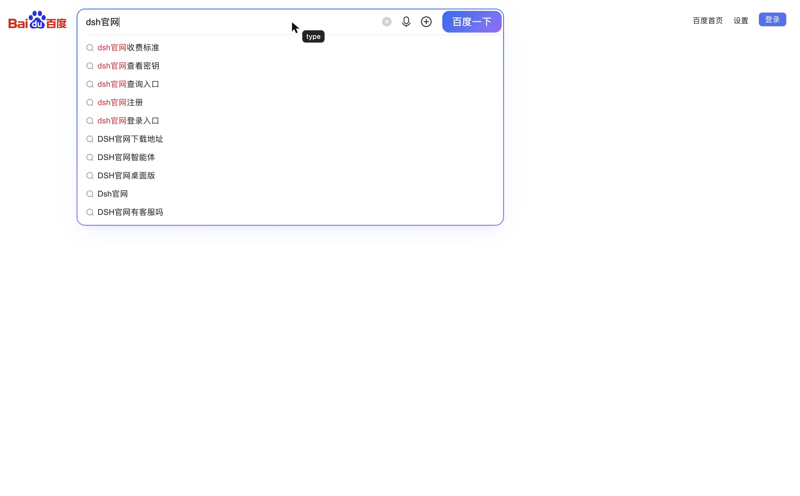

# dsh-browser-use

[English](README.md) | 简体中文

面向 [DeepSeek Harness](https://github.com/deepseek-ai) 的后台浏览器自动化插件。干净重写：一个离屏 Electron 窗口、CDP 输入、编号快照 ref、不抢焦点。

这不是另一个浏览器插件的 fork。它与 `dsh-builtin-browser` 不共享包 id、工具名、客户端模块、设置路由或浏览器窗口。

## 功能

- 首次工具调用时才惰性启动真实 Electron/Chromium 窗口。
- 窗口离屏停放、opacity 0、`skipTaskbar`；工具路径从不调用 `show()`、`focus()`、`moveTop()` 或 `Page.bringToFront()`。
- 通过 Chrome DevTools Protocol 驱动页面：真实鼠标事件、`Input.insertText`、`Page.captureScreenshot`、`Runtime.evaluate`。
- 在页面内绘制光标（箭头 + 动作气泡、点击涟漪），逐字符输入，动作可见但不依赖系统指针。
- `browser_use_snapshot` 返回编号元素 ref；ref 只在当次快照内有效。
- DSH 界面在后台时仍可工作；不移除 display surface，因此 CDP 输入不会被丢弃。

## 工具

| 工具 | 用途 |
| --- | --- |
| `browser_use_open` | 打开 http(s) URL 并返回快照 |
| `browser_use_snapshot` | 返回编号的可交互元素 |
| `browser_use_click` | 按快照 ref 执行真实鼠标点击 |
| `browser_use_type` | 聚焦元素、绘制光标、逐字符输入 |
| `browser_use_screenshot` | 保存 JPEG 并返回路径 |
| `browser_use_eval` | 执行页面 JavaScript |
| `browser_use_wait` | 等待加载 / 选择器 / 文本 / URL |
| `browser_use_assert` | 校验选择器、文本、URL 或 JS 真值 |
| `browser_use_state` | URL、标题、readyState、首段可见文本 |
| `browser_use_back` / `browser_use_reload` | 后退 / 刷新 |
| `browser_use_close` | 停止 host 进程 |

## 安装

```bash
npm install
npm test        # 单元 + host 端到端（需要 Electron）
```

作为 DSH bundle，把包安装到 profile（或链接 checkout），由 bundle patch 添加 `dsh-browser-use` 行。如果包依赖没有下载 Electron，插件会使用 profile 里的 Electron；设置 `ELECTRON_PATH` 指向一个 Electron 可执行文件可覆盖。

要求：Node >= 22.19，DSH >= 0.1.1-rc.2 < 0.3.0，Electron 44+。

## 视觉反馈

`browser_use_type` 和 `browser_use_click` 会向页面注入一个 `pointer-events-none` 覆盖层：黑色箭头、动作气泡（`type` 或 `click`）和点击涟漪。覆盖层在页面内，因此会出现在 `browser_use_screenshot` 里，且永远不会移动用户的真实光标。



## 测试

```bash
npm test
```

五项测试覆盖 host、注册的工具面、bundle 元数据，以及端到端的 `open → type → click → assert → screenshot` 路径。手动百度 smoke（`dsh官网`，11 个结果标题）记录在 [`docs/testing-zh.md`](docs/testing-zh.md)（[English](docs/testing.md)）。

## 架构

```
DSH host 插件（index.js）
  └─ HostClient（src/client.js）        惰性 spawn，走回环 TCP 的带 token JSON-RPC
       └─ host/main.cjs                Electron 主进程
            ├─ BrowserWindow           show:false → showInactive → opacity 0 → 离屏停放
            ├─ webContents.debugger    CDP 1.3
            └─ snapshot / click / type / screenshot / eval / wait
```

子进程在 stdout 打印一行 ready（`{ "port": ... }`）。父进程连接 `127.0.0.1`，先发送 `{ op: "hello", token }`（每次 spawn 随机生成 token），然后才发命令。命令串行执行；第二个连接会被拒绝。

## 窗口规则

- 创建时 `show: false`。
- 先 `showInactive()`，再 `setOpacity(0)`，然后停放到工作区之外。
- `setSkipTaskbar(true)`、`setFocusable(false)`、`setMinimizable(false)`。
- macOS 默认显示 Electron Dock 图标。点击图标（或它的菜单）可显示浏览器窗口；任何工具都不会主动抬起窗口。设置 `BROWSER_USE_HIDE_DOCK=1` 隐藏 Dock 图标，或 `BROWSER_USE_KEEP_DOCK=1` 强制显示。
- 如果窗口被系统最小化，host 会静默恢复、重新离屏停放，并保持 opacity 0。
- 任何工具路径都不会调用 `Page.bringToFront()`。

## 已知限制

- 单标签；`browser_use_open` 会替换当前页面。
- 快照暂不包含同源 iframe 和 shadow root。
- 截图只截当前视口，不是整页滚动截图。
- 输入通过 `Input.insertText` 逐字符完成；可见，但节奏刻意保守（约 18 ms/字符）。
- 光标注入在顶层文档，不会画进跨域 iframe。
- host 以 macOS 为先；Windows/Linux 未实测。
- 多显示器下，被系统夹回屏幕内的离屏窗口可能在 Mission Control 里显示为一个空白 tile；它保持透明且点击穿透，但还没有原生 z-order（orderBack）。
- 屏幕共享/录制在窗口显示前看不到页面，因为后台窗口 opacity 为 0。
- 没有客户端设置面板。bundle 行是唯一开关。

## 许可证

MIT。见 [LICENSE](./LICENSE)。

## 查看浏览器

host 默认后台运行：窗口透明、离屏、不可聚焦，且永远不会被工具带到前台。要查看当前页面：

- macOS：点击 Electron Dock 图标，或使用菜单「显示浏览器窗口」/「隐藏到后台」。
- 窗口会在活动显示器上以 1400x900 显示；关闭它即回到后台（页面继续存活）。
- 只在你查看时显示：切换到其他应用（包括 DSH）会自动回到透明离屏状态，下一次工具调用仍只在后台进行。再次点击 Dock 图标可重新打开。
- `BROWSER_USE_HIDE_DOCK=1` 隐藏 Dock 图标；`BROWSER_USE_KEEP_DOCK=1` 强制显示。
