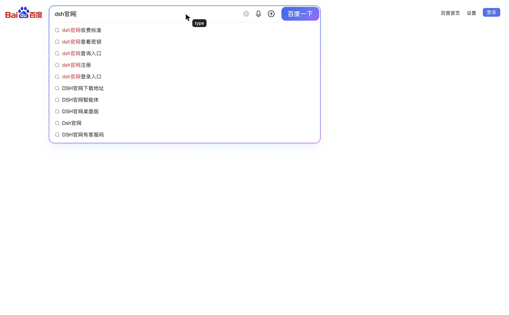

# dsh-browser-use

Background browser automation for [DeepSeek Harness](https://github.com/deepseek-ai). A clean rewrite: one offscreen Electron window, CDP input, numbered snapshot refs, and no focus stealing.

This is not a fork of another browser plugin. It shares no package id, tool name, client module, settings route, or browser window with `dsh-builtin-browser`.

## What it does

- Starts a real Electron/Chromium window lazily on the first tool call.
- Parks the window offscreen with opacity 0 and `skipTaskbar`; tools never call `show()`, `focus()`, `moveTop()`, or `Page.bringToFront()`.
- Drives the page over the Chrome DevTools Protocol: real mouse events, `Input.insertText`, `Page.captureScreenshot`, `Runtime.evaluate`.
- Draws a page-local cursor (arrow + action bubble, click ripple) and inserts text one character at a time, so actions are visible without depending on the OS pointer.
- Gives the model numbered element refs from `browser_use_snapshot`; refs are valid for that snapshot only.
- Works while the DSH UI is in the background; no display surface is removed, so CDP input is not dropped.

## Tools

| Tool | Purpose |
| --- | --- |
| `browser_use_open` | Open an http(s) URL and return a snapshot |
| `browser_use_snapshot` | Numbered interactive elements |
| `browser_use_click` | Real mouse click by snapshot ref |
| `browser_use_type` | Focus an element, draw the cursor, insert text character by character |
| `browser_use_screenshot` | Save a JPEG and return its path |
| `browser_use_eval` | Evaluate page JavaScript |
| `browser_use_wait` | Wait for load / selector / text / URL |
| `browser_use_assert` | Check selector, text, URL, or JS truthiness |
| `browser_use_state` | URL, title, readyState, first visible text |
| `browser_use_back` / `browser_use_reload` | History / reload |
| `browser_use_close` | Stop the host process |

## Install

```bash
npm install
npm test        # unit + host end-to-end (needs Electron)
```

As a DSH bundle, install the package into a profile (or link the checkout) and let the bundle patch add the `dsh-browser-use` row. The plugin uses the profile's Electron if the package dependency has not downloaded one; set `ELECTRON_PATH` to a bare Electron executable to override.

Requirements: Node >= 22.19, DSH >= 0.1.1-rc.2 < 0.3.0, Electron 44+.

## Visual feedback

`browser_use_type` and `browser_use_click` inject a pointer-events-none overlay into the page: a black arrow, an action bubble (`type` or `click`), and a click ripple. The overlay lives in the page, so it appears in `browser_use_screenshot` and never moves the user's real cursor.



## Testing

```bash
npm test
```

Five tests cover the host, the registered tool surface, the bundle metadata, and an end-to-end `open → type → click → assert → screenshot` path. A manual Baidu smoke test (`dsh官网`, 11 result headings) is documented in [`docs/testing.md`](docs/testing.md).

## Architecture

```
DSH host plugin (index.js)
  └─ HostClient (src/client.js)        lazy spawn, authenticated JSON-RPC over loopback TCP
       └─ host/main.cjs                Electron main process
            ├─ BrowserWindow           show:false → showInactive → opacity 0 → park offscreen
            ├─ webContents.debugger    CDP 1.3
            └─ snapshot / click / type / screenshot / eval / wait
```

The child prints one ready line (`{ "port": ... }`) on stdout. The parent connects to `127.0.0.1`, sends `{ op: "hello", token }` with a random per-spawn token, and only then issues commands. Commands are serialized; a second connection is refused.

## Window rules

- `show: false` at creation.
- `showInactive()`, then `setOpacity(0)`, then park outside the work area.
- `setSkipTaskbar(true)`, `setFocusable(false)`, `setMinimizable(false)`.
- On macOS the Electron Dock icon is shown by default. Click it (or use its menu) to reveal the browser window; the window is never raised by a tool. Set `BROWSER_USE_HIDE_DOCK=1` to hide the Dock icon, or `BROWSER_USE_KEEP_DOCK=1` to force it on.
- If the window is minimized by the OS, the host restores it silently, re-parks it, and keeps opacity 0.
- No tool path calls `Page.bringToFront()`.

## Limitations

- One tab; `browser_use_open` replaces the current page.
- Same-origin iframes and shadow roots are not yet included in snapshots.
- Screenshot captures the viewport, not a full-page scroll.
- Typing is character-by-character through `Input.insertText`; it is visible but deliberately modest (about 18 ms per character).
- The cursor is injected into the top document; it is not drawn inside cross-origin iframes.
- The host is macOS-first; Windows/Linux are untested.
- On multi-display setups the clamped offscreen window can appear as a blank tile in Mission Control; it stays transparent and click-through, but there is no native z-order (orderBack) yet.
- Screen sharing/capture sees no page until the window is revealed, because the background window is opacity 0.
- No client settings panel. The bundle row is the only switch.

## License

MIT. See [LICENSE](./LICENSE).

## Viewing the browser

The host runs headless by default: the window is transparent, offscreen, unfocused, and never brought forward by a tool. To inspect the current page:

- macOS: click the Electron Dock icon, or use its menu `显示浏览器窗口` / `隐藏到后台`.
- The window appears at 1400x900 on the active display; close it to send it back to the background (the page stays alive).
- Shown only while you are using it: switching to another app (including DSH) automatically returns the window to the transparent offscreen state, and the next tool call stays background-only. Click the Dock icon again to re-open it.
- `BROWSER_USE_HIDE_DOCK=1` hides the Dock icon; `BROWSER_USE_KEEP_DOCK=1` forces it visible.
